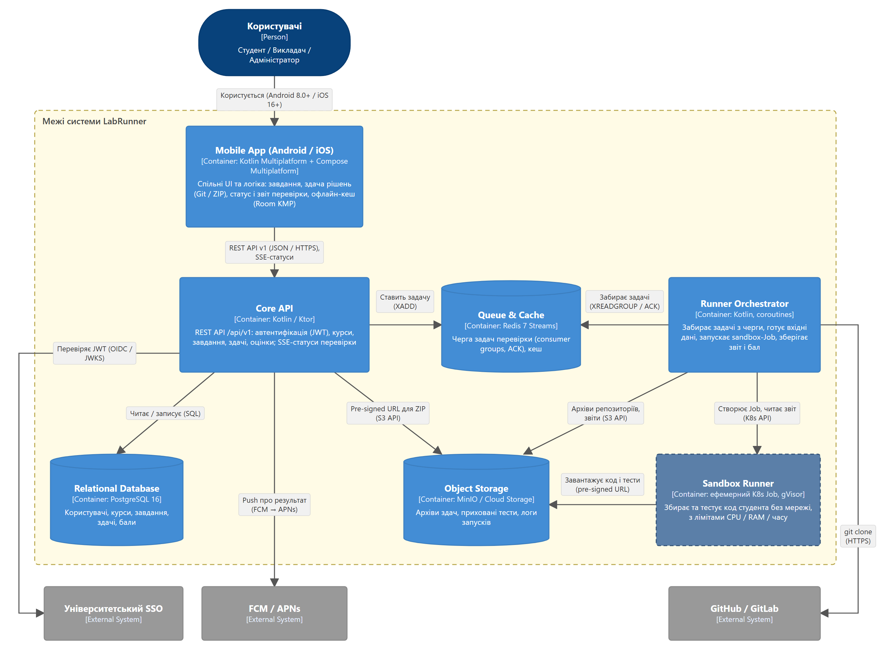

# LabRunner

[](https://github.com/VladDev-git/LabRunner/actions/workflows/ci.yml)

Сервіс автоматизованої перевірки програмних завдань з мобільним клієнтом для Android та iOS (Kotlin Multiplatform).
Навчальний проєкт з дисципліни «Життєвий цикл ПЗ та DevOps-технології» (ТНТУ, кафедра програмної інженерії).

Студент здає рішення (Git-репозиторій або код) із застосунку, сервер ставить здачу в чергу, Runner Orchestrator перевіряє її та зберігає звіт, а студент бачить статус і бал.

## Архітектура



| Компонент | Технології | Опис |
|---|---|---|
| `composeApp` | Kotlin Multiplatform, Compose Multiplatform, Ktor Client | Мобільний застосунок Android / iOS |
| `server/api` | Kotlin, Ktor 3, JDBC + HikariCP | Core API `/api/v1`, міграції БД, постановка задач у чергу |
| `server/orchestrator` | Kotlin, Lettuce, MinIO SDK | Споживач черги, перевірка здач, звіти в S3 |
| `shared/contracts` | Kotlin Multiplatform, kotlinx.serialization | DTO, спільні для клієнта й сервера |
| `db` | PostgreSQL 16 | Завдання, здачі, бали |
| `redis` | Redis 7 Streams (AOF) | Черга перевірок `labrunner:submissions` |
| `storage` | RustFS (S3-сумісне сховище) | JSON-звіти перевірок |

Архітектурні рішення: [docs/adr](docs/adr).

## Швидкий старт (локальне середовище)

Потрібні Docker Desktop (Compose v2+) та вільний порт 8080.

```bash
cp .env.example .env        # змініть паролі
docker compose up -d --build
docker compose ps           # усі сервіси мають статус (healthy)
curl http://localhost:8080/health
```

Зупинка: `docker compose down` (дані зберігаються в томах), повне очищення: `docker compose down -v`.

### Мережі та безпека

- `public-net` — лише `api`, єдиний порт на хості: `8080`.
- `backend-net` (`internal: true`) — `db`, `redis`, `storage`, `api`, `orchestrator`; без виходу в інтернет і без опублікованих портів.
- Власні образи працюють від непривілейованого користувача `labrunner` (uid 10001).

## API

| Метод | Шлях | Опис |
|---|---|---|
| GET | `/health` | Стан сервісу (БД + Redis) |
| GET | `/api/v1/assignments` | Список завдань |
| POST | `/api/v1/assignments` | Створити завдання |
| POST | `/api/v1/submissions` | Здати рішення → `202 Accepted`, статус `QUEUED` |
| GET | `/api/v1/submissions?student=...` | Здачі студента |
| GET | `/api/v1/submissions/{id}` | Статус і бал |
| GET | `/api/v1/submissions/{id}/report` | JSON-звіт перевірки |

```bash
curl -X POST http://localhost:8080/api/v1/submissions \
  -H "Content-Type: application/json" \
  -d '{"assignmentId":1,"studentName":"Владислав Петрик","sourceCode":"fun main() { println(42) }"}'
```

## Мобільний застосунок

```bash
./gradlew :composeApp:installDebug                                # емулятор: API на http://10.0.2.2:8080
./gradlew :composeApp:assembleDebug -Plabrunner.apiUrl=http://192.168.0.10:8080   # реальний пристрій
```

iOS: див. [iosApp/README.md](iosApp/README.md) (збірка на macOS).

## Структура репозиторію

```
composeApp/          KMP-клієнт (androidMain, iosMain, commonMain)
iosApp/              SwiftUI-обгортка для iOS
server/api/          Ktor Core API + Dockerfile
server/orchestrator/ Runner Orchestrator + Dockerfile
shared/contracts/    спільні DTO
docs/adr/            Architecture Decision Records
infra/terraform/     Terraform: kvm (локальна VM) і azure
infra/ansible/       Ansible: налаштування Docker-хоста, GitHub runner
deploy/              production-стек (compose, Caddy), моніторинг, скрипт деплою
docs/architecture/   діаграми C4 / Deployment
docker-compose.yml   локальне середовище
.env.example         шаблон конфігурації
```

## CI (GitHub Actions)

Конвеєр `.github/workflows/ci.yml` запускається для кожного Pull Request у `main`, для push у `main` і для тегів `vX.Y.Z`:

| Етап | Джоба | Що перевіряє |
|---|---|---|
| 1 | Lint | ktlint, Android Lint, Hadolint |
| 2 | Tests | unit + Testcontainers (PostgreSQL), Android unit-тести, debug APK |
| 2 | iOS | тести на iOS-симуляторі, iOS-фреймворк (macOS) |
| 3 | Security scan | Trivy: залежності (`gradle.lockfile`), конфігурації, секрети |
| 4 | Build, scan & push | Docker-образ → Trivy → GHCR (`sha-<commit>`, SemVer) |
| 4 | IaC validate | `terraform validate` (kvm, azure), `ansible-lint` |
| 5 | Deploy | лише `main`: self-hosted runner у VM → `deploy/scripts/deploy.sh` → smoke test |

Образи: `ghcr.io/vladdev-git/labrunner-api`, `ghcr.io/vladdev-git/labrunner-orchestrator`.

## Інфраструктура як код (infra/)

Terraform створює сервер, Ansible налаштовує його як Docker-хост (UFW, SSH без паролів, fail2ban, Docker Engine + Compose). Terraform сам генерує `infra/ansible/inventory.ini`.

| Каталог | Ціль | Стан |
|---|---|---|
| `infra/terraform/kvm` | KVM/QEMU через libvirt (WSL2), NAT-мережа `10.40.1.0/24` | застосовується |
| `infra/terraform/azure` | Azure: VNet, NSG, Public IP, VM Ubuntu 24.04 | валідується в CI |

```bash
# у WSL2 (потрібні terraform, ansible, libvirt)
cd infra/terraform/kvm && terraform init && terraform apply
cd ../../ansible && ansible-playbook playbook.yml     # повторний запуск: changed=0
cd ../terraform/kvm && terraform destroy
```

Стан Terraform (`*.tfstate`) і `terraform.tfvars` не комітяться. Рішення: [ADR-0006](docs/adr/0006-iac-terraform-ansible.md).

## Розгортання та моніторинг (deploy/)

Після злиття в `main` джоба **Deploy** (environment `production`) на self-hosted runner у VM виконує `deploy/scripts/deploy.sh`: розгортає образи `sha-<commit>` з GHCR і перевіряє `/health` та наскрізну здачу.

| Сервіс | Призначення |
|---|---|
| `proxy` (Caddy) | єдиний вхід на порт 80: API, `/grafana/`; `/metrics` закрито |
| `prometheus` | збір метрик: API, Orchestrator, Node Exporter, cAdvisor |
| `node-exporter`, `cadvisor` | метрики хоста та контейнерів |
| `grafana` | дашборди `LabRunner — Service RED & Containers`, `Node Exporter Full`; алерти в Telegram |

Секрети — у GitHub Environment `production`. Рішення: [ADR-0007](docs/adr/0007-cd-and-observability.md).

## Стан за лабораторними

- [x] Лаба 1 — аналіз, вимоги, C4, ADR-0001…0003
- [x] Лаба 2 — контейнеризація, Docker Compose, 12-Factor, ADR-0004
- [x] Лаба 3 — CI: GitHub Actions, Quality Gates, Trivy, GHCR, ADR-0005
- [x] Лаба 4 — IaC: Terraform (KVM, Azure), Ansible, ADR-0006
- [x] Лаба 5 — CD (self-hosted runner, smoke test), Prometheus, Grafana, алерти в Telegram, ADR-0007
